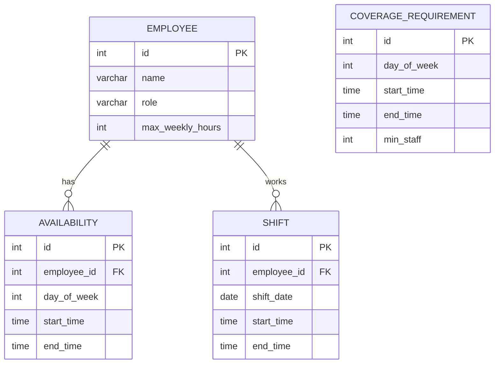

# Shift Scheduler

A Java and SQL application that generates weekly employee schedules from staff availability and coverage requirements. It enforces labor rules automatically and reports any slots it could not staff.

The business rules come from real restaurant management experience: balancing availability, labor limits, and peak-hour staffing is a manual, error-prone task, and this project automates it.

## Problem Statement

Building a weekly schedule by hand means juggling employee availability, maximum weekly hours, rest requirements, and minimum staffing for busy periods. Mistakes cause understaffed shifts, overworked employees, and last-minute fixes. This application takes those constraints as input and produces a valid schedule, flagging anything it cannot satisfy.

## Features

- Manage employees, roles, and maximum weekly hours
- Record weekly availability windows per employee
- Define minimum staffing requirements per day and time slot
- Auto-generate a weekly schedule that respects all business rules
- Detect and report unfilled coverage gaps
- SQL-based reports (hours per employee, coverage gaps)
- Persistent storage in an embedded database (no installation required)
- Unit-tested scheduling rules

## Tech Stack

| Area | Technology |
|---|---|
| Language | Java 17 |
| Build | Maven |
| Database | H2 (embedded, file-based) |
| Data access | JDBC with `PreparedStatement` (DAO pattern) |
| Testing | JUnit 5 |
| Version control | Git / GitHub |

## Project Structure

```
shift-scheduler/
├── pom.xml
├── README.md
├── src/main/java/com/yourname/scheduler/
│   ├── Main.java              # CLI entry point
│   ├── model/                 # Employee, Availability, Shift, CoverageRequirement
│   ├── db/                    # Database connection + DAOs
│   └── service/               # RuleValidator, ScheduleGenerator, ReportService
├── src/main/resources/schema.sql
└── src/test/java/...          # JUnit tests
```

## Database Schema



## Business Rules

A shift is only assigned if **all** of the following hold:

1. The employee is available for the entire shift window
2. The shift does not overlap another shift for the same employee
3. The employee's total weekly hours stay within their maximum
4. There are at least 8 hours of rest between consecutive shifts
5. Each coverage slot aims to reach its minimum staff; if it cannot, it is reported as a gap

## Getting Started

### Prerequisites

- JDK 17 or newer
- Maven 3.8+

### Build and test

```bash
git clone https://github.com/<your-username>/shift-scheduler.git
cd shift-scheduler
mvn clean test
```

### Run

```bash
mvn compile exec:java -Dexec.mainClass="com.yourname.scheduler.Main"
```

Or build a jar:

```bash
mvn clean package
java -jar target/shift-scheduler-1.0.jar
```

The H2 database file is created automatically under `./data/` on first run and the schema is applied from `schema.sql`.

### Usage

The CLI menu offers:

```
1) Add employee
2) Set availability
3) Set coverage requirement
4) Generate schedule
5) View schedule
6) Reports
7) Exit
```

## Sample Output

> Replace this block with real output from your own run.

```
Weekly Schedule
---------------------------------------------
Mon  09:00-17:00  <employee name>
Mon  09:00-17:00  <employee name>
...

Hours per Employee
---------------------------------------------
<employee name>   32.0
<employee name>   28.5

Coverage Gaps
---------------------------------------------
Sat 18:00-22:00  needed 3, assigned 2
```

## Design Decisions

**Greedy scheduling algorithm.** For each coverage slot, the generator collects employees who pass every rule, sorts them by fewest hours assigned so far, and assigns until the minimum staff is met. This is simple, fast, predictable, and easy to test. It also spreads hours fairly across staff. A constraint solver would find better schedules in tight cases, but would add complexity that is not justified at this scale.

**H2 embedded database.** H2 runs in-process with no server setup, so anyone can clone the repo and run it immediately. The schema uses standard SQL, so moving to PostgreSQL or MySQL would mainly mean changing the JDBC URL and driver.

**DAO pattern with `PreparedStatement`.** Database access is isolated in DAO classes, and every query is parameterized, which keeps SQL separate from business logic and prevents SQL injection.

**Pure-Java rule validator.** `RuleValidator` makes no database calls. It takes data in and returns a decision, which makes each rule easy to unit test in isolation.

## Testing

```bash
mvn test
```

JUnit 5 tests cover each business rule, including boundary cases (shifts that touch but do not overlap, exact maximum-hour limits, exact rest-period boundaries) and the generator's gap reporting.

## Known Limitations

- Greedy assignment does not guarantee an optimal schedule and can leave gaps that a smarter algorithm could fill
- Schedules are generated one week at a time with no carry-over of hours between weeks
- Overnight shifts that cross midnight are not supported
- No shift preferences, role-specific coverage, or time-off requests
- Command-line interface only

## Future Improvements

- Role-based coverage requirements (for example, a minimum number of managers per shift)
- Time-off and shift-preference support
- REST API (Spring Boot) with a web frontend
- Export schedules to CSV or PDF
- Backtracking or constraint-solver approach for tighter schedules

## Author

**<Your Name>**: Computer Science, University of Regina
GitHub: https://github.com/<your-username> | Email: <your-email>
