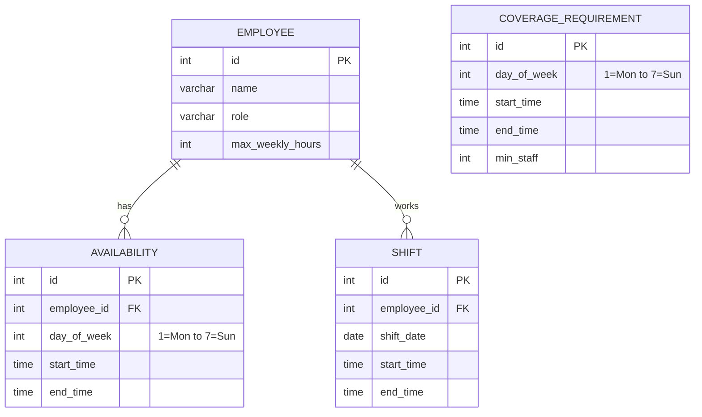

# Shift Scheduler

A command-line Java application that stores employees, availability and staffing needs in a SQL database, generates a weekly schedule that respects labor rules, and reports on hours and coverage gaps.

## The problem

Building a shift schedule by hand means checking several rules at once: who is available, who is near their hour limit, who just closed and can't open the next morning. Mistakes are easy to make, and understaffed slots often go unnoticed until the shift arrives. This tool applies the rules automatically and reports any slot it could not fill.

## Features

- Stores employees, availability, coverage needs and shifts in a SQL database that persists between runs
- Generates a weekly schedule that spreads hours fairly across staff
- Enforces five business rules (below)
- Reports hours per employee and coverage gaps using SQL queries
- Uses `PreparedStatement` for every query, so user input can't inject SQL (there is a test for this)
- Includes 36 JUnit tests, covering rule boundaries and the real SQL against an in-memory database

## Business rules

1. An employee can only be scheduled within their availability.
2. A person's shifts can't overlap.
3. Weekly hours (Monday to Sunday) can't exceed the employee's maximum.
4. Employees get at least 8 hours of rest between shifts, including across midnight and between weeks.
5. Each coverage slot should reach its minimum staff. If it can't, it is flagged as a gap.

## Tech stack

Java 17, Maven, JDBC, H2 (file-based, no install needed), JUnit 5

## Database schema



`CHECK` constraints in [schema.sql](src/main/resources/schema.sql) also reject invalid days and times that end before they start.

## How to run

You need JDK 17 or newer with `JAVA_HOME` set. You don't need to install Maven, because the included wrapper downloads it on first use. On macOS or Linux, use `./mvnw` in place of `.\mvnw.cmd`.

Run the tests:

```bash
.\mvnw.cmd test
```

Start the app:

```bash
.\mvnw.cmd -q compile exec:java
```

Or build a standalone jar and run that:

```bash
.\mvnw.cmd package
```

```bash
java -jar target/shift-scheduler-1.0.0.jar
```

**In VS Code:** install the recommended Extension Pack for Java, then press F5 and choose **Run Shift Scheduler**.

Data is saved in `data/` in the folder you run from. Delete that folder to start over.

## Sample output

Choose option `8` to load a small fictional store, then `4` to generate a week:

```text
Created 20 shifts for the week of Mon Nov 9, with 5 coverage gaps.
  Mon Nov 9 15:00-21:00: 1 of 2 staff (short 1)
  Tue Nov 10 15:00-21:00: 1 of 2 staff (short 1)
  Wed Nov 11 15:00-21:00: 1 of 2 staff (short 1)
  Sat Nov 14 10:00-18:00: 2 of 3 staff (short 1)
  Sun Nov 15 10:00-18:00: 1 of 3 staff (short 2)
```

Option `5` shows the schedule:

```text
Mon Nov 9
  09:00-15:00  Alex Morgan      Shift Lead
  09:00-15:00  Sam Rivera       Cashier
  15:00-21:00  Priya Shah       Stock
Tue Nov 10
  09:00-15:00  Alex Morgan      Shift Lead
  09:00-15:00  Sam Rivera       Cashier
  15:00-21:00  Priya Shah       Stock
...
```

Option `6` shows the reports:

```text
Hours per employee
  Alex Morgan       30.0 / 40 hrs
  Priya Shah        30.0 / 40 hrs
  Jordan Lee        18.0 / 24 hrs
  Sam Rivera        18.0 / 32 hrs
  Taylor Brooks     16.0 / 16 hrs
  Chris Nguyen      14.0 / 20 hrs
```

The sample data is deliberately tight. On Monday to Wednesday evenings, the rest rule and availability leave too few people. By the weekend, Jordan and Chris don't have enough weekly hours left for an 8-hour shift.

## Project layout

```text
src/main/java/com/vraj/scheduler/
├── Main.java                  CLI menu
├── model/                     Employee, Availability, CoverageRequirement, Shift, CoverageGap
├── db/                        Database connection and one DAO per table
└── service/
    ├── RuleValidator.java     The labor rules, with no database access
    ├── ScheduleGenerator.java The greedy algorithm, with no database access
    ├── SchedulingService.java Loads data, runs the generator, saves the result
    ├── ReportService.java     SQL reports
    └── SampleData.java        Demo data
```

## Design decisions

**Greedy algorithm.** The generator walks slots in time order and gives each one to the eligible employees with the fewest hours so far. It is fast, deterministic and easy to explain to the person who has to trust the schedule. The trade-off is that it never revisits an earlier choice, so it can miss a schedule that fills more slots. An exact solver would find the best answer, but adds far more complexity than this scope justifies.

**H2.** It runs embedded with nothing to install, so anyone can clone and run the project. It is still real SQL over JDBC, so moving to PostgreSQL or MySQL would mostly mean changing the driver and adjusting a few H2-specific pieces, such as the `MERGE` syntax and date functions.

**Rules and algorithm kept separate from the database.** `RuleValidator` and `ScheduleGenerator` take plain Java objects, so the edge cases can be tested directly and quickly.

**Coverage gaps calculated with SQL.** The gap report queries the saved shifts rather than storing the generator's list. It stays correct after a restart and can't go out of date. A test confirms that it matches the generator's result.

**Regenerating replaces the week.** Generating a week again overwrites that week's shifts in a single transaction, so a failure leaves the previous schedule intact and running it twice never creates duplicates.

## Known limitations

- Shifts can't cross midnight, so overnight work isn't supported.
- The rest rule stops one person from working two adjoining slots on the same day. Combining them into one longer slot avoids this.
- Each shift must fit inside a single availability window, and adjoining windows aren't merged.
- The menu replaces an employee's availability for each chosen day, so it sets one window per day. The database and rules support more.
- Roles are stored but not used for matching, so a slot can't require a specific role.
- The menu can't edit or delete employees or remove coverage slots.
- There are no manual shift edits. Generating a week overwrites it.
